<div align="center">


# DocForge

**Incremental document-intelligence ETL for LLMs.**
Turn a messy folder of PDFs, DOCX files and spreadsheets into chunked, embedded, schema-validated records,<br/>
reprocess only what changed, and trace every extracted value back to the page and box it came from.

[](backend/pyproject.toml)
[](backend/src/docforge/api)
[](backend/src/docforge/extraction/schemas)
[](backend/alembic/versions)
[](backend/src/docforge/worker/main.py)
[](backend/src/docforge/extraction/providers/anthropic.py)
<br/>
[](web/package.json)
[](web/tsconfig.json)
[](web/components.json)
[](backend/pyproject.toml)
[](.github/workflows/ci.yml)
[](LICENSE)

[Why](#why-this-exists) · [Features](#feature-highlights) · [Screenshots](#screenshots) · [Architecture](#architecture) · [Quickstart](#quickstart) · [API](#api-overview) · [Decisions](#engineering-decisions-and-trade-offs)

<br/>

<picture>
  <source media="(prefers-color-scheme: dark)" srcset="docs/screenshots/provenance-dark.png" />
  <source media="(prefers-color-scheme: light)" srcset="docs/screenshots/provenance-light.png" />
  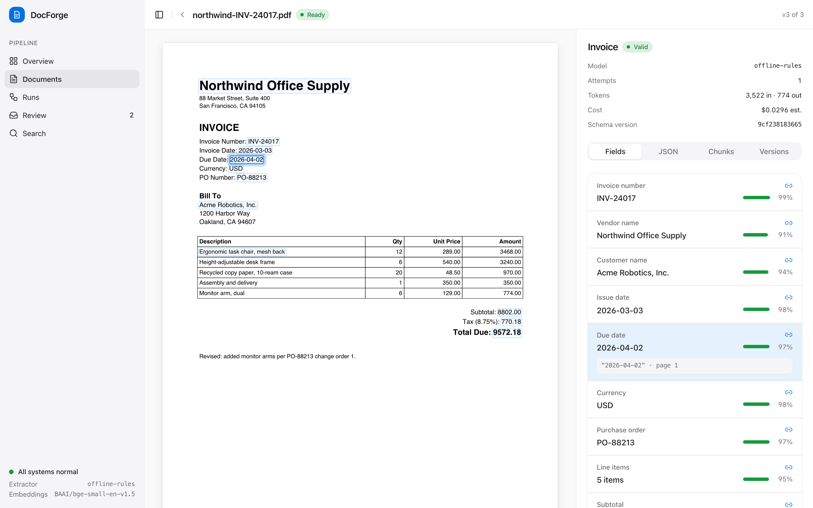
</picture>

<sub>The provenance viewer. Selecting <i>Due date</i> highlights the exact words on the page it was read from, with the verbatim evidence quote and a grounded confidence score.</sub>

</div>

---

## Why this exists

Most "chat with your documents" demos re-parse, re-embed and re-prompt the whole corpus on every run, then hand back JSON with no way to tell where a number came from. That is fine for a demo and expensive and unauditable in production.

DocForge treats document intelligence as a **data engineering problem**:

- **Incremental by construction.** Every stage output is memoized under an idempotency key derived from the content hash, the stage's config version and its output schema. A re-run over 14 unchanged documents costs $0.00 and finishes in about 10 ms.
- **Schema-locked, not prompt-locked.** Extraction targets are plain Pydantic models. Business rules such as `total == subtotal + tax` live in validators, and validation errors are fed back to the LLM in a bounded repair loop.
- **Provenance down to the box.** Each field carries a verbatim evidence quote, a page number and a bounding box. Confidence is checked against the page, not taken from the model's word for it.
- **Humans where it matters.** Fields below the confidence threshold, or failing validation, go to a review queue. A record only reaches the typed warehouse tables once it validates.

## Feature highlights

| | |
|---|---|
| **Pluggable sources with change detection** | `SourceConnector` protocol with a local filesystem source and an S3-compatible source (MinIO, AWS). Listing uses cheap fingerprints (`stat` or ETag); the detect stage confirms with SHA-256, so a touched-but-identical file is never re-parsed, re-embedded or re-billed. |
| **Layout-aware parsing** | `Parser` protocol: PDF via pdfplumber (words with boxes, tables), DOCX via python-docx, XLSX and CSV via openpyxl. Everything normalizes into a typed `DocumentModel` of pages, blocks and words, and each box records whether it comes from real layout, reading flow or a cell grid. |
| **Structure-aware chunking** | Chunks never cross a heading. Tables are chunked separately by rows with the header repeated. Every chunk stores its heading path plus the page and box of each block it came from. |
| **Schema-locked LLM extraction** | Registered Pydantic models (`Invoice`, `Contract` bundled, more via `SCHEMA_MODULES`) are wrapped in a strict evidence envelope `{value, evidence, source_block, confidence}` and filled by Claude through JSON-schema structured outputs. Validation failures trigger up to `EXTRACTION_MAX_REPAIRS` repair attempts. |
| **Offline deterministic extractor** | With no API key, a rules-based provider follows the same envelope and repair contract, so the demo, tests and CI run with no network and no cost. |
| **Grounded confidence** | Each value is located on the page (exact match, fuzzy match, block match or none) and blended with the model's own confidence, with penalties for repaired values and open validation issues. |
| **Human-in-the-loop review** | Low-confidence and invalid fields become review items. Reviewers approve or correct values; edits are type-checked against the field annotation, and the whole record is re-validated before it is approved into the entity tables. |
| **DAG runner with retries and a DLQ** | Stages form a DAG that runs level by level (chunk and extract run concurrently). Exponential backoff with full jitter, permanent and retryable errors told apart, a dead-letter table with one-click replay, and a reaper that re-enqueues stalled runs. |
| **Run ledger and cost accounting** | Every stage execution records items in and out, tokens, cost, duration and cache savings. The UI shows what each run spent and what incrementality saved. |
| **Three sinks** | pgvector `chunks` (partial HNSW index over current chunks) for RAG, typed `invoices` / `invoice_line_items` / `contracts` tables plus a generic `entity_records` table, and a per-run Parquet export (chunks, fields, stages). |
| **Viewer built for audit** | Next.js 15 + shadcn/ui: react-pdf rendering with clickable provenance boxes, chunk overlays, version history, a run timeline, a keyboard-driven review queue and semantic search. |

## Screenshots

**Overview.** Spend, savings from incrementality, stage-cache hits and the dead-letter queue at a glance.

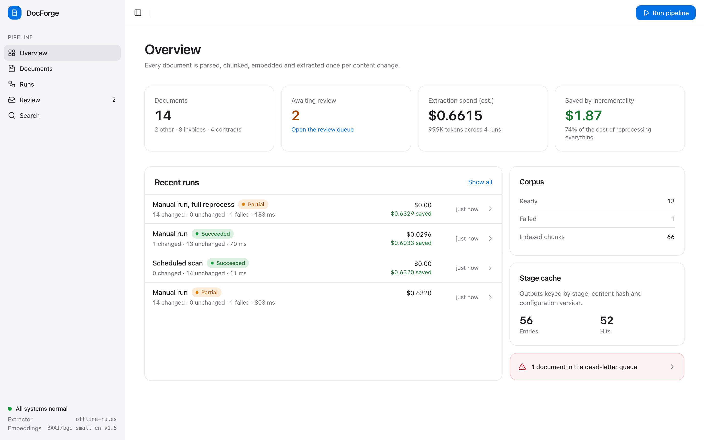

**Review queue.** A total that breaks `total == subtotal + tax`, shown with its rule, evidence and source box.

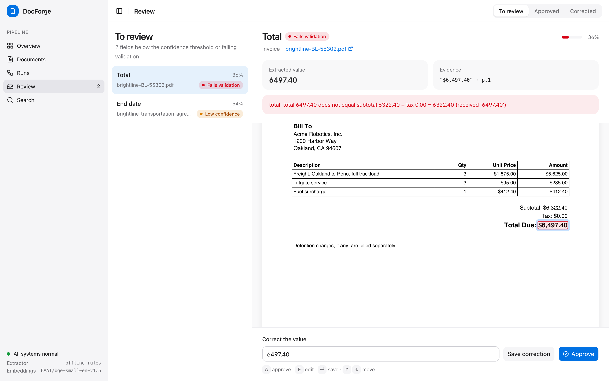

**Run ledger.** A forced reprocess: parse, chunk, embed and extract are all cache hits, so $0.63 of LLM spend is avoided.

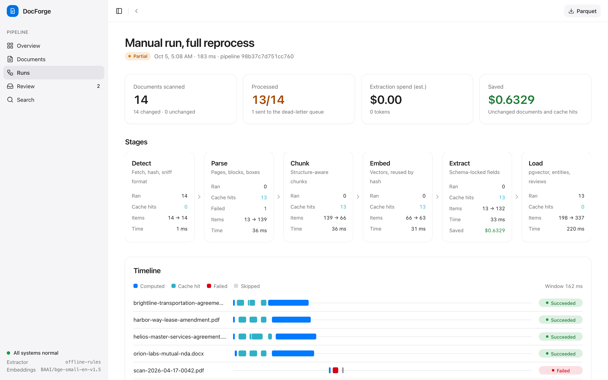

**Timeline and DLQ.** The first load: per-document stage bars, and a truncated scan dead-lettered at the parse stage while the other 13 succeed.

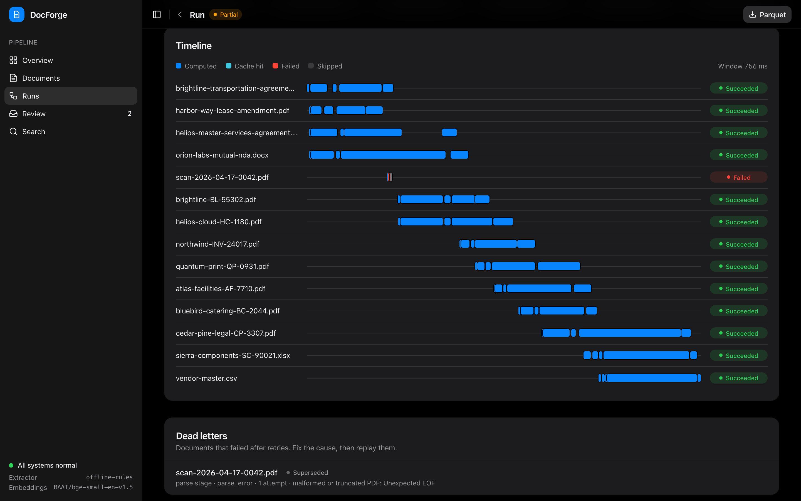

**Chunks and repair loop.** Heading-aware chunks over a DOCX contract, each mapped back to its blocks, plus the validation errors the first extraction attempt was repaired from.

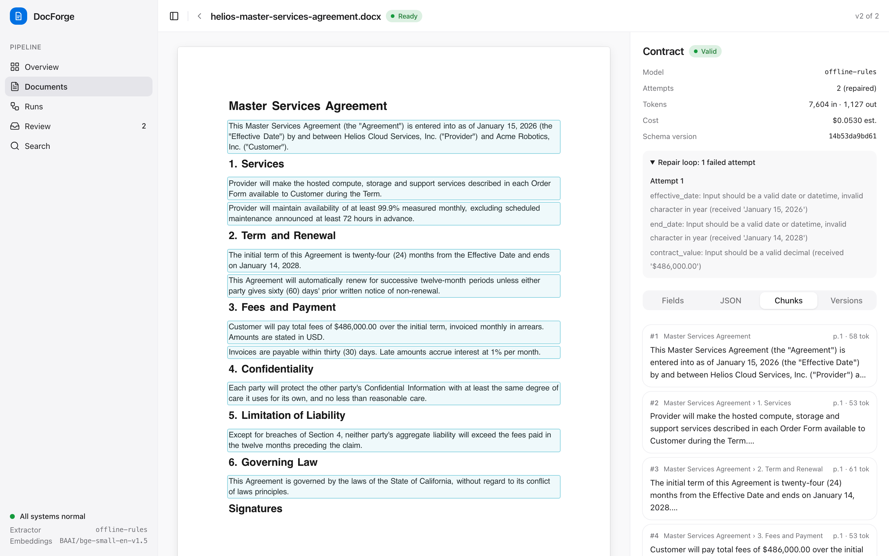

**Semantic search.** The RAG read path: pgvector cosine search over current chunks, with heading path and page.

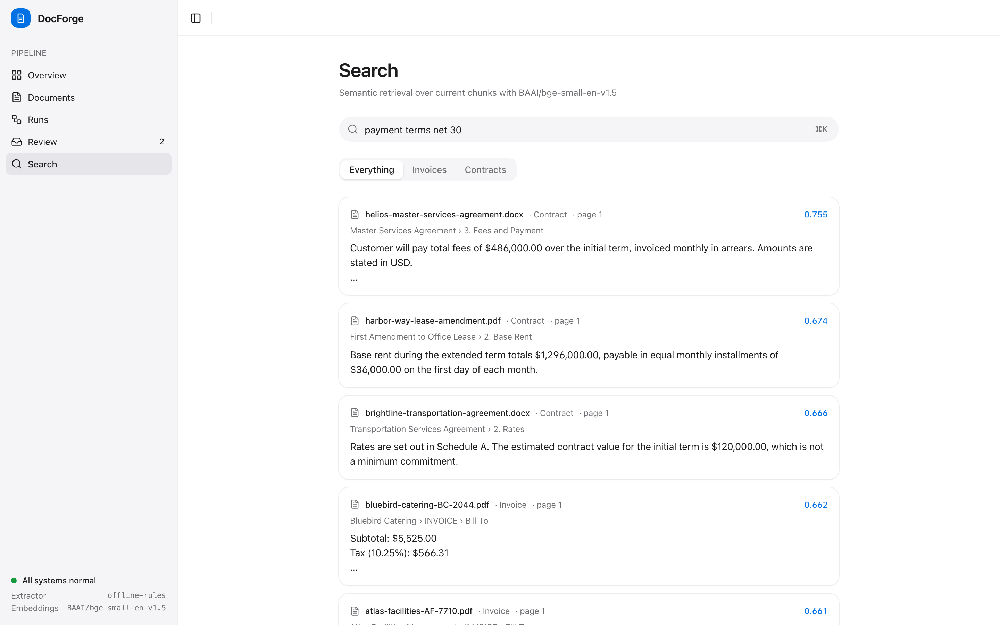

**Documents.** Every tracked document with its extraction status, average grounded confidence and version count.

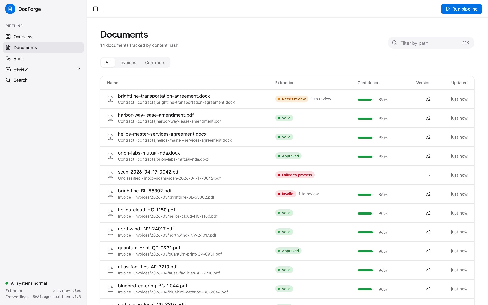

## Architecture

### System overview

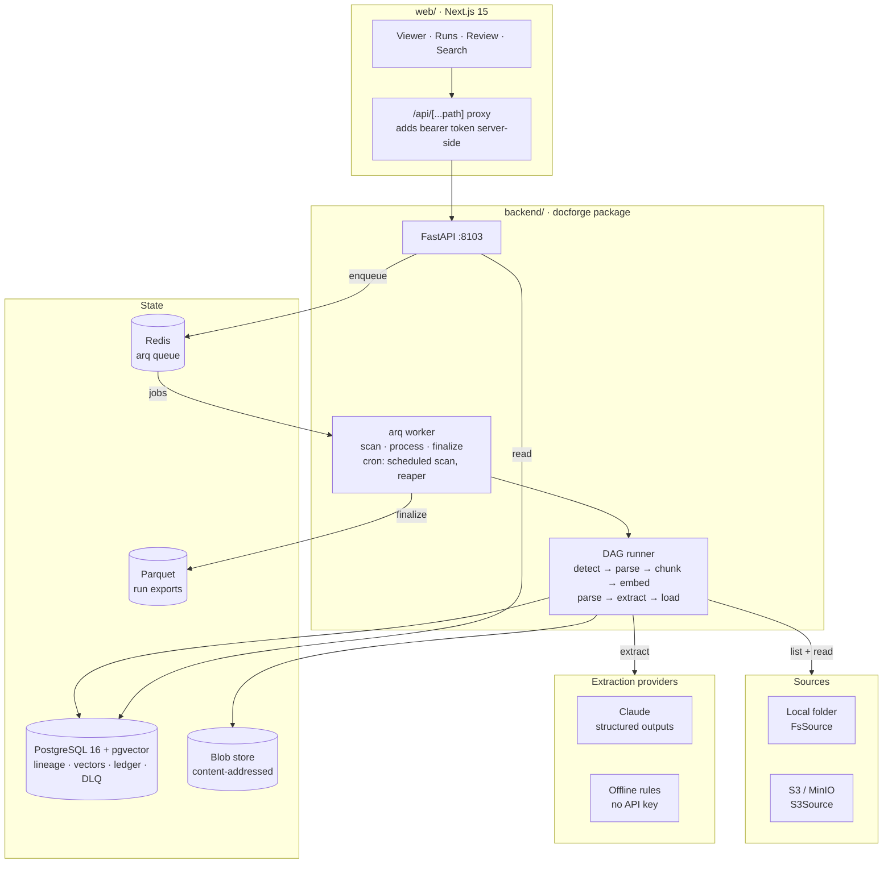

### The stage DAG

Each stage is keyed by `hash(stage, config_version, output_schema, upstream identities)`. Detect exposes the **content hash** as its identity, so everything downstream is keyed by content, not by where the bytes came from.

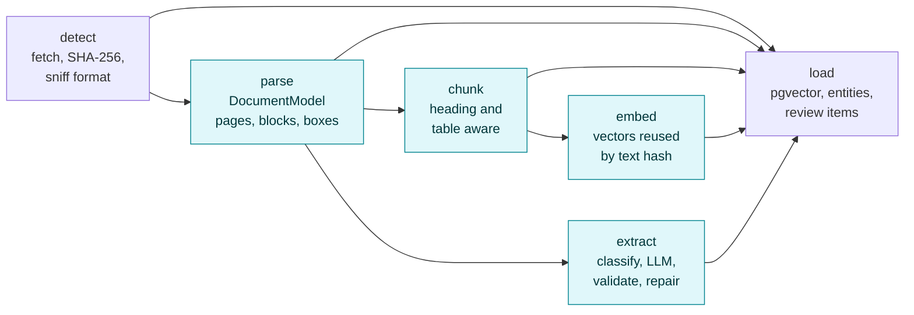

<sub>Highlighted stages are memoized in the <code>stage_cache</code> table. Detect is never cached; when the bytes match the current version it halts the DAG, so nothing downstream runs or gets billed.</sub>

### Core flow: a run, end to end

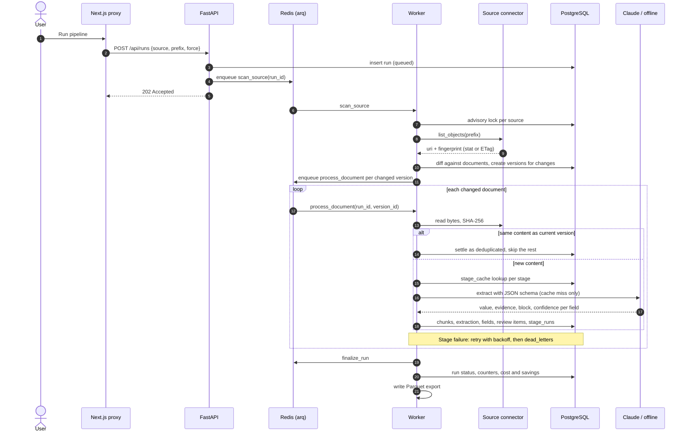

### Extraction with validation and repair

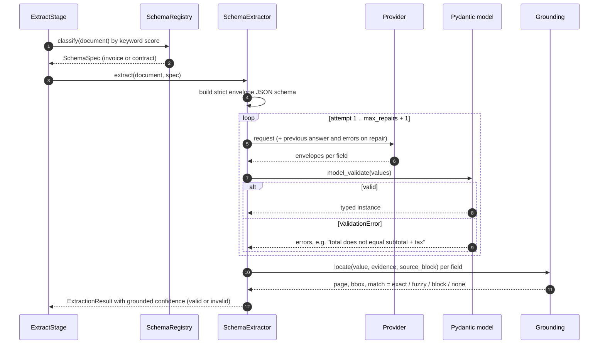

### User flow

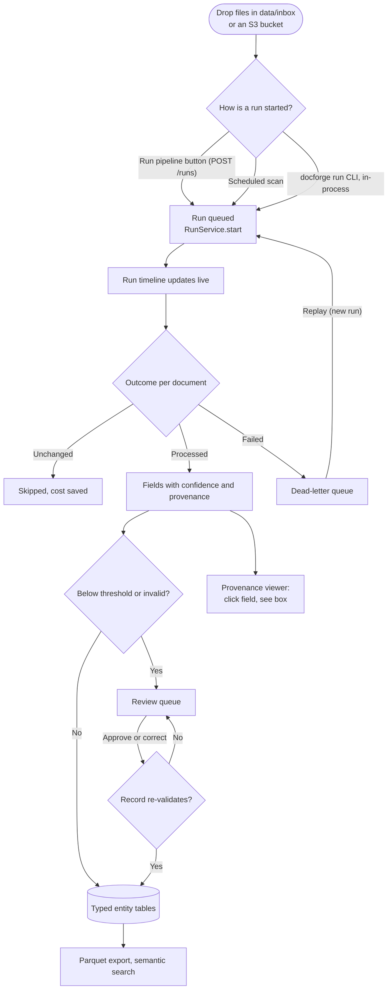

### Data model

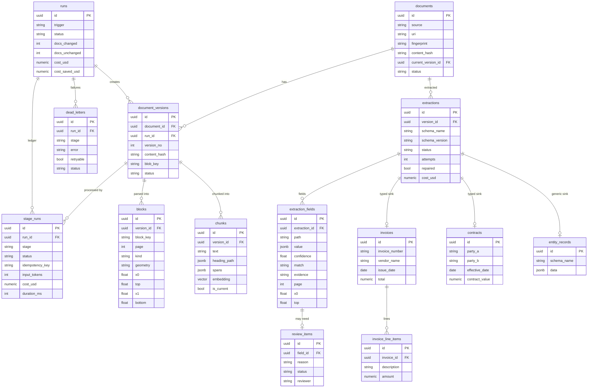

<sub>Also present: <code>stage_cache</code> (idempotency key to JSONB output and metrics, with hit counts) and <code>embedding_cache</code> (model plus text hash to vector).</sub>

## Tech stack

| Layer | Choice | Why |
|---|---|---|
| API | FastAPI, Pydantic v2, pydantic-settings | Typed request and response models end to end; settings validated at boot |
| Jobs | arq on Redis, JSON job serializer | Async-native workers with cron; JSON instead of pickle so Redis can never inject code |
| Storage | PostgreSQL 16, pgvector (HNSW), SQLAlchemy 2.0 async, asyncpg, Alembic | One transactional store for lineage, vectors, ledger and the typed warehouse |
| Parsing | pdfplumber, python-docx, openpyxl | Word-level boxes and tables from PDFs; structure from DOCX and spreadsheets |
| Embeddings | fastembed (`BAAI/bge-small-en-v1.5`), hashing fallback | Local CPU embeddings, no API needed; deterministic fallback for tests |
| Extraction | Anthropic SDK, JSON-schema structured outputs, effort control | Strict schema enforcement at the model; offline rules provider with the same contract |
| Sources | Local filesystem, aioboto3 for S3 and MinIO | Same `SourceConnector` protocol for both |
| Export | pyarrow (Parquet) | Columnar, typed hand-off to a warehouse or notebook |
| Web | Next.js 15 App Router, TypeScript strict, shadcn/ui, TanStack Query, Zod, react-pdf | Runtime-validated API responses; a PDF canvas with an absolutely positioned highlight layer |
| Quality | ruff, mypy `--strict` (pydantic plugin), pytest, ESLint, Vitest, GitHub Actions | 96 backend tests (unit plus Postgres integration) and 18 web tests |

## Engineering decisions and trade-offs

**Idempotency keys are content-derived, not path-derived.** The root stage is keyed by the source fingerprint, but detect publishes the SHA-256 as its identity. Moving or re-uploading a file therefore hits the same cache entries, and changing a parser version, chunk size, embedding model or schema invalidates exactly the stages that depend on it. Output models are part of the key too: a changed Pydantic output schema can never load a stale cache entry.

**Two-level change detection.** Listing compares cheap fingerprints (`size:mtime:inode` for files, ETag for S3), so a scheduled scan reads no unchanged bytes. Fingerprints have false positives (a `touch`, a multipart re-upload); the detect stage catches those with the real hash and halts before anything is billed.

**The envelope pattern for structured outputs.** Structured outputs guarantee shape, not truth. Each field is wrapped as `{value, evidence, source_block, confidence}`, the JSON schema is made strict (closed objects, all properties required, unsupported keywords removed), and business rules stay in Pydantic validators. The two complement each other: the model cannot return malformed JSON, and the pipeline still rejects an invoice whose numbers do not add up.

**Bounded repair, then a human.** A repair attempt sends a fresh single-turn request quoting the failed answer and the structured validation errors. If the document itself is inconsistent (the bundled Brightline invoice prints a total that does not match its lines), no repair can succeed; the result is stored as `invalid` with the failing field flagged for review instead of being "fixed" by the model.

**Confidence that has to be earned.** `score = 0.5 * model_confidence + 0.5 * grounding`, where grounding is 1.0 for an exact word match on the page, 0.85 fuzzy, 0.7 block-level and 0.3 when the value cannot be found. Repaired values and fields with open issues are penalized. A model that is sure of a value it cannot point to still lands in review.

**Exactly-once accounting on an at-least-once queue.** Jobs can be delivered twice (worker crash after the work but before the ack) and the reaper re-enqueues stalled runs. A version's terminal status and the run counters change in one transaction, guarded by the version still being in flight, so each document is counted once. Scans over the same source take a Postgres advisory lock so version numbers never collide.

**Review is gated by the schema.** Approving or editing the last pending field re-validates the whole record; if it still breaks a rule the decision is rejected with the failing rule. Nothing invalid reaches `invoices` or `contracts`.

**Older versions stay queryable.** Chunks and extractions carry `is_current`; the HNSW index is partial over current chunks, and search uses pgvector's iterative scan so filtered queries still return the requested number of hits.

**Auth without ceremony locally.** Without `API_TOKENS`, writes are accepted only from loopback, which is the Next.js proxy. With tokens set, a bearer token is required and names the reviewer recorded on decisions. The token lives server-side in the proxy and never reaches the browser.

**Trade-offs taken knowingly**

- The stage cache lives in Postgres JSONB. It is simple and transactional, but large parse outputs would be better in object storage with a pointer in the table.
- Schema classification is keyword-scored rather than LLM-routed: cheap, deterministic and explainable, but a new document type needs keywords as well as a model.
- Boxes for DOCX are synthesized from reading flow (`geometry = flow`) because DOCX has no fixed layout. The viewer renders a reconstructed page for those formats, and the geometry kind is stored so consumers know how far to trust a box.
- Cost is estimated from list prices in `extraction/pricing.py`. The offline provider is priced as the configured model, so the demo shows realistic numbers flagged as `est.`

## Project structure

```text
docforge-etl/
├── backend/
│   ├── alembic/versions/          # 0001 initial schema, 0002 checks, FK indexes, partial HNSW
│   ├── src/docforge/
│   │   ├── api/                   # FastAPI app, routes, auth (bearer or loopback), error mapping
│   │   ├── sources/               # SourceConnector protocol, FsSource, S3Source, blob store, hashing
│   │   ├── parsing/               # Parser protocol, PDF / DOCX / XLSX / CSV, layout helpers
│   │   ├── chunking/              # StructureAwareChunker
│   │   ├── embedding/             # fastembed and hashing embedders
│   │   ├── extraction/            # registry, envelope, extractor (repair loop), grounding, confidence
│   │   │   ├── providers/         # Anthropic (structured outputs) and offline rules provider
│   │   │   └── schemas/           # Invoice, Contract
│   │   ├── pipeline/              # Stage protocol, DAG runner, stages, caches, ledger, queue, service
│   │   ├── sinks/                 # pgvector chunks, typed entity tables, Parquet exporter
│   │   ├── services/              # read models and use cases behind the API
│   │   ├── db/                    # SQLAlchemy models, repositories, sessions
│   │   ├── worker/                # arq WorkerSettings, cron scan, stale-run reaper
│   │   ├── corpus/                # sample corpus generator (invoices, contracts, broken scan)
│   │   └── cli.py                 # docforge migrate | seed | run | generate-corpus
│   └── tests/                     # unit/ and integration/ (needs Postgres with pgvector)
├── web/
│   └── src/
│       ├── app/                   # overview, documents/[id], runs/[id], review, search, api proxy
│       ├── components/            # viewer/ (react-pdf + highlights), inspector/, runs/, review/, ui/
│       └── lib/api/               # Zod schemas, typed client, TanStack Query hooks
├── sample-corpus/                 # generated invoices (PDF, XLSX), contracts (DOCX, PDF), CSV, broken scan
├── scripts/                       # local-infra.sh (Postgres + Redis without Docker)
├── docs/screenshots/
├── docker-compose.yml             # postgres (pgvector), redis, minio + seed, api, worker, web
└── Makefile
```

## Quickstart

### Local (no Docker)

Requirements: Python 3.12+ (the Makefile defaults to `python3.13`; override with `PYTHON=`), Node 22+ with pnpm 9, Redis, and PostgreSQL 16 with the [pgvector](https://github.com/pgvector/pgvector) extension available to `pg_ctl`.

```bash
make install    # backend/.venv with dev + fastembed extras, and pnpm install for web/
make infra      # Postgres on :5503 and Redis on :6403 (loopback only, password docforge-dev); state in .local/
make seed       # migrate, copy sample-corpus/ into data/inbox, build a demo history
```

Then either start everything at once:

```bash
make dev        # API :8103, arq worker, web :3103 (Ctrl-C stops all)
```

or in separate shells:

```bash
make api        # http://127.0.0.1:8103  (OpenAPI docs at /docs)
make worker
cd web && pnpm build && DOCFORGE_API_ORIGIN=http://localhost:8103 pnpm start   # or: make web
```

Open **http://localhost:3103**. Stop the databases with `make infra-stop`.

`make seed` truncates DocForge's tables and only ever writes to `data/inbox`. It tells a story you can explore in the UI:

```text
1. initial load              partial    seen=14 changed=14 ok=13 failed=1   cost=$0.6320 est.
2. nothing changed           succeeded  seen=14 changed=0  unchanged=14     cost=$0.0000  saved=$0.6320
3. one invoice re-issued     succeeded  seen=14 changed=1  unchanged=13     cost=$0.0296  saved=$0.6033
4. review approved           quantum-print due_date (due on receipt)
5. review edited             orion-labs term_months -> 24
6. full reprocess (force)    partial    seen=14 changed=14 ok=13 failed=1   cost=$0.0000  saved=$0.6329
```

To extract with Claude instead of the offline provider, set `ANTHROPIC_API_KEY` in `.env` (see [Configuration](#configuration)). To run the pipeline once without Redis or a worker: `make run`.

### Docker Compose

```bash
cp .env.example .env    # optional: ANTHROPIC_API_KEY, DOCFORGE_API_TOKEN
make up                 # postgres (pgvector), redis, minio + bucket seed, api, worker, web; then seeds demo data
make down
```

In Compose, the API requires a bearer token (`DOCFORGE_API_TOKEN`, default `change-me-local-token`), which the web container adds server-side. MinIO is mirrored from `sample-corpus/` and registered as the `s3` source, and the worker's scheduled scan is enabled.

## Configuration

All settings are read by `docforge.config.Settings` from the environment or `.env`; every value has a working local default.

| Variable | Default | Purpose |
|---|---|---|
| `DATABASE_URL` | `postgresql+asyncpg://docforge@localhost:5503/docforge` | PostgreSQL with pgvector |
| `REDIS_URL` | `redis://:docforge-dev@localhost:6403/0` | arq queue |
| `CORS_ORIGINS` | `["http://localhost:3103"]` | Allowed browser origins |
| `API_TOKENS` | unset | JSON map of bearer token to reviewer name. Unset: writes accepted from loopback only. Required when `ENVIRONMENT=production` |
| `FS_SOURCE_ROOT` | `./data/inbox` | Folder the `fs` source reads |
| `DATA_DIR` | `./data` | Blobs, Parquet exports, model cache |
| `S3_ENDPOINT_URL`, `S3_BUCKET`, `S3_PREFIX`, `S3_ACCESS_KEY_ID`, `S3_SECRET_ACCESS_KEY` | unset, `docforge-inbox` | Enables the `s3` source when an endpoint or key is set |
| `LLM_PROVIDER` | `auto` | `auto` uses Claude when `ANTHROPIC_API_KEY` is set, `offline` otherwise; or force `anthropic` / `offline` |
| `ANTHROPIC_API_KEY` | unset | Claude API key |
| `EXTRACTION_MODEL` | `claude-opus-5-5` | Model id, also used for cost estimation |
| `EXTRACTION_EFFORT` | `medium` | `low`, `medium`, `high`, `xhigh`, `max` |
| `EXTRACTION_MAX_REPAIRS` | `2` | Repair attempts after a validation failure (0 to 5) |
| `EXTRACTION_REFUSAL_FALLBACK` | `true` | Use the server-side refusal fallback beta |
| `REVIEW_CONFIDENCE_THRESHOLD` | `0.8` | Fields below this go to the review queue |
| `SCHEMA_MODULES` | `[]` | Importable modules exposing `SCHEMAS: list[SchemaSpec]` |
| `EMBEDDING_PROVIDER` | `auto` | `auto` (fastembed with hashing fallback), `fastembed`, `hashing` |
| `FASTEMBED_MODEL` | `BAAI/bge-small-en-v1.5` | Downloaded once into `DATA_DIR/models` |
| `CHUNK_MAX_TOKENS` | `320` | Chunk budget (64 to 2048) |
| `STAGE_MAX_ATTEMPTS` | `3` | In-process retries per stage before dead-lettering |
| `WORKER_MAX_JOBS` | `4` | Concurrent jobs per worker |
| `RUN_STALE_AFTER_SECONDS` | `900` | The reaper re-enqueues runs idle for longer than this |
| `SCHEDULED_SCAN_ENABLED` | `false` | Cron scan of the `fs` source |
| `SCHEDULED_SCAN_MINUTE_INTERVAL` | `15` | Minutes between scheduled scans |
| `LOG_LEVEL`, `LOG_JSON` | `INFO`, `false` | structlog output |
| `DOCFORGE_API_ORIGIN` (web) | `http://localhost:8103` | Where the Next.js proxy forwards `/api/*` |
| `DOCFORGE_API_TOKEN` (web) | unset | Bearer token the proxy adds server-side |

### Registering your own schema

```python
# my_company/schemas.py
from pydantic import BaseModel
from docforge.extraction.registry import SchemaSpec

class PurchaseOrder(BaseModel):
    po_number: str
    supplier: str
    total: float

SCHEMAS = [
    SchemaSpec(
        name="purchase_order",
        model=PurchaseOrder,
        description="Purchase order issued to a supplier",
        instructions="Copy amounts exactly as printed.",
        keywords={r"\bpurchase order\b": 2.0, r"\bpo number\b": 1.5},
    )
]
```

Set `SCHEMA_MODULES=["my_company.schemas"]`. A schema's version is a hash of its JSON schema and instructions, so editing either re-extracts the affected documents on the next run. Schemas without a dedicated table are written to `entity_records`.

## Testing

```bash
make lint typecheck test build    # what CI runs
```

- **Backend:** `ruff`, `mypy --strict` over `src` and `tests`, and 109 pytest tests. Unit tests cover parsers, layout, the chunker, the envelope, grounding, confidence, the repair loop, the Anthropic provider request shape, sources (including S3 through moto), the DAG runner (keys, caching, retries, halts) and worker retry logic. Integration tests run the full pipeline and the API against a real Postgres, plus recovery scenarios: a scan that crashed mid-way, a load that committed before a crash, an older version finishing late, concurrent runs on one source, idempotent finalize and the reaper restarting a lost run.
- **Integration database:** `TEST_DATABASE_URL` (default `postgresql+asyncpg://docforge@localhost:5503/docforge_test`, created on demand). Run `make infra` first. Without Postgres the integration tests skip; with `CI=true` they fail instead.
- **Web:** ESLint, `tsc --noEmit` in strict mode, and Vitest for geometry, API schemas, review value parsing, keyboard shortcuts and the review detail component.

## API overview

Interactive docs at `http://localhost:8103/docs`. Every route is under `/api`; the routes marked as writes require a writer (a bearer token, or loopback when no tokens are configured).

| Method | Path | Description |
|---|---|---|
| `GET` | `/health` | Database, queue, extraction provider and embedder status |
| `GET` | `/overview` | Corpus counts, pending reviews, spend and savings, cache stats |
| `GET` | `/schemas` | Registered extraction schemas and their versions |
| `POST` | `/runs` | **Write.** Start a run `{source, prefix, force, bypass_cache}`, returns 202 |
| `GET` | `/runs` | Paginated run history |
| `GET` | `/runs/{id}` | Run detail with per-stage aggregates and its dead letters |
| `GET` | `/runs/{id}/timeline` | Per-document stage executions for the timeline |
| `GET` | `/runs/{id}/export/{chunks\|fields\|stages}.parquet` | Download the run's Parquet export |
| `GET` | `/documents` | Filter by `kind`, `status`, `q`; paginated |
| `GET` | `/documents/{id}` | Document with its version history |
| `GET` | `/documents/{id}/extraction` | Extracted data and fields with provenance (`?version_id=`) |
| `GET` | `/documents/{id}/blocks` | Parsed blocks with boxes |
| `GET` | `/documents/{id}/chunks` | Chunks with spans and heading paths |
| `GET` | `/documents/{id}/file` | Original bytes for the viewer, from the blob store |
| `GET` | `/reviews` | Review items by `status` (`pending`, `approved`, `edited`, `superseded`) |
| `GET` | `/reviews/{id}` | One review item |
| `POST` | `/reviews/{id}/approve` | **Write.** Approve the value `{note}` |
| `POST` | `/reviews/{id}/edit` | **Write.** Correct the value `{value, note}`; type-checked and re-validated |
| `GET` | `/search?q=&kind=&limit=` | Semantic search over current chunks |
| `GET` | `/dead-letters` | Dead-lettered versions by `status` |
| `POST` | `/dead-letters/{id}/replay` | **Write.** Re-run the failed version in a new single-document run |

```bash
curl -s -X POST localhost:8103/api/runs -H 'content-type: application/json' -d '{"force": false}'
curl -s 'localhost:8103/api/search?q=late%20payment%20interest&limit=3'
```

## Roadmap

- [ ] Persist large stage outputs (parsed documents) to the blob store, keeping only pointers in `stage_cache`
- [ ] OCR fallback for scanned PDFs without a text layer (the bundled broken scan currently dead-letters)
- [ ] LLM-assisted schema routing when keyword classification is ambiguous
- [ ] Field-level lineage in Parquet exports for line items, not only top-level fields
- [ ] Per-reviewer audit log and reviewer agreement metrics
- [ ] Hybrid retrieval (BM25 plus vectors) and reranking on the search endpoint
- [ ] OpenTelemetry traces per run and stage

## License

[MIT](LICENSE)
